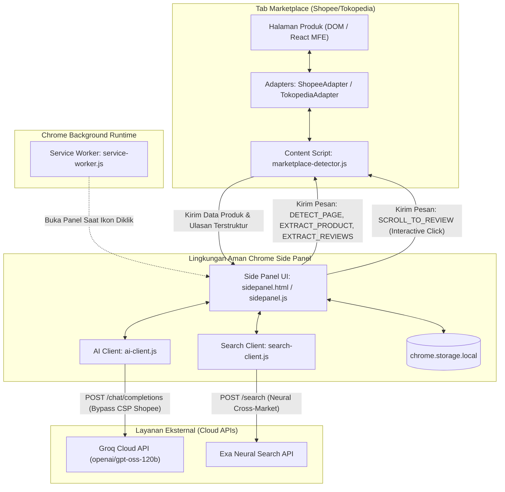
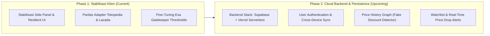

# 🚀 Shopping Intelligence Companion — Project Progress & Context Anchor

> **Core Value:** *"Before you buy, understand the deal."*  
> Mentransformasi belanja daring dari sekadar tebak-tebakan harga menjadi keputusan pembelian yang terverifikasi, rasional, dan bebas penyesalan dengan asisten cerdas terintegrasi di **Chrome Side Panel**.

---

## 1. Executive Summary & Core Value

### 1.1 Visi: Ultimate AI Shopping Companion
**Shopping Intelligence** adalah ekstensi Google Chrome modern berbasis **Manifest V3** yang dirancang sebagai asisten belanja cerdas (*Ultimate AI Shopping Companion*). Ekstensi ini aktif mendampingi pengguna secara *real-time* saat menjelajahi marketplace e-commerce utama di Indonesia (Shopee, Tokopedia, Lazada, dan Blibli).

Berbeda dari ekstensi pembanding harga konvensional yang pasif, kaku, atau sekadar melakukan *scraping query* teks ke Google Shopping, Shopping Intelligence menghadirkan pemahaman kognitif mendalam terhadap transaksi e-commerce. Ekstensi ini mengekstrak data langsung dari state internal aplikasi web marketplace, menganalisis ulasan pembeli asli dengan Large Language Model (LLM), mengaudit keaslian klaim garansi, dan mencari penawaran alternatif terbaik lintas platform secara semantik.

### 1.2 Filosofi Produk: *"Before you buy, understand the deal."*
Di ekosistem belanja daring Indonesia, harga murah sering kali menjebak pembeli dalam kompromi tersembunyi:
- **Diskon Semu & Tipuan Aksesoris:** Produk berharga murah ternyata hanyalah aksesoris (misalnya cover kasur atau bantal tiup, bukan springbed yang dicari).
- **Diskrepansi Garansi:** Deskripsi penjual mencantumkan klaim "Garansi Resmi 1 Tahun", namun data sistem e-commerce mencatat "Tidak Ada Garansi" atau "Garansi Toko 7 Hari".
- **Ulasan yang Terkubur:** Ulasan negatif kritis (barang cacat, barang palsu/KW, penipuan pengiriman) tertimbun oleh ratusan ulasan bintang 5 instan tanpa teks.

Shopping Intelligence hadir untuk membedah anatomi produk sebelum pengguna menekan tombol *Checkout*. Dengan menganalisis keaslian penawaran, ekstensi ini memberikan keputusan objektif: **BUY**, **CHECK**, atau **WAIT**.

### 1.3 Perombakan Arsitektur: Dari Popup ke Side Panel
Pada versi awal, antarmuka ekstensi menggunakan Chrome Popup window (maksimal 600px). Arsitektur ini memiliki kelemahan ergonomis fatal: popup otomatis tertutup jika pengguna mengeklik di luar jendela (misalnya saat membaca deskripsi di tab utama), menghilangkan state analisis dan memaksa pengguna mengulang proses pemindaian.

Ekstensi kini telah dimigrasikan secara total ke **Chrome Side Panel API**. Side panel berjalan persisten di sisi kanan peramban, memberikan kanvas vertikal penuh yang memungkinkan interaksi dua arah antara ringkasan AI dan halaman marketplace aktif tanpa gangguan sesi.

---

## 2. Tech Stack & Arsitektur Sistem (Current State)

### 2.1 Ringkasan Teknologi

| Komponen | Teknologi | Deskripsi & Implementasi Teknis |
| :--- | :--- | :--- |
| **Platform Runtime** | **Chrome Extension MV3** | Menggunakan Service Worker, Permission Model ketat, dan declarative content scripts. |
| **Antarmuka Pengguna (UI)** | **Chrome Side Panel API** | UI vertikal persisten sepanjang sesi belanja; terintegrasi via `chrome.sidePanel.setPanelBehavior`. |
| **Sistem Desain** | **Playful Geometric** | Estetika Neo-Brutalism/Memphis 80s: *Hard Shadows* (`4px 4px 0px #000`), border hitam solid `2px`, palet kontras tinggi, font Outfit & Plus Jakarta Sans. |
| **AI Intelligence Engine** | **Groq API (`openai/gpt-oss-120b`)** | Inferensi ultra-cepat dengan `response_format: { type: "json_object" }` untuk parsing data semantik, evaluasi penawaran, dan peringkasan ulasan. Dilengkapi mekanisme fallback ke `llama-3.1-70b-versatile`. |
| **Neural Search Engine** | **Exa API (Search Endpoint)** | Pencarian semantik berorientasi produk pada domain marketplace target (`shopee.co.id`, `tokopedia.com`, `lazada.co.id`, `blibli.com`). |
| **Data Scraping & Extraction** | **God-Level Scraper** | Ekstraksi bertingkat (*Cascade Merge Pattern*): MFE JSON State (`<script type="text/mfe-initial-data">`) $\rightarrow$ Schema.org JSON-LD $\rightarrow$ Direct DOM Heuristics. |
| **Penyimpanan Lokal & Caching**| **`chrome.storage.local`** | *Write-through caching* hasil analisis berbasis URL tab (`cache_v2_{url}`) untuk menyajikan pemindaian instan (*zero-latency cache hit*) dan penghematan kuota API. |

---

### 2.2 Diagram Alur Arsitektur Komunikasi Ekstensi



---

## 3. Fitur yang Sudah Selesai (Versi Terbaru)

### 3.1 God-Level Scraper (Shopee Adapter)
Shopee me-render halamannya menggunakan arsitektur Micro-Frontend (MFE) React yang mengaburkan nama kelas CSS (*hash obfuscation*) dan memuat data secara dinamis. Untuk menjamin keandalan ekstraksi tanpa rentan patah akibat pembaruan CSS, diimplementasikan **Cascade Merge Pattern 3 Lapis**:

1. **Layer 1 — MFE JSON State Parsing:**
   - Menelusuri elemen `<script type="text/mfe-initial-data">` pada dokumen Shopee.
   - Mengurai objek JSON internal untuk memperoleh atribut teknis spesifikasi lengkap (`product_attributes`), data detail toko resmi (`shop_detailed`), dan status keaslian.
2. **Layer 2 — Schema.org JSON-LD Parsing:**
   - Mengekstrak blok data terstruktur `<script type="application/ld+json">`.
   - Mengambil data semantik standar seperti rating rata-rata, jumlah ulasan, nama merek, dan schema penawaran (*Offers*).
3. **Layer 3 — Direct DOM & OpenGraph Heuristic Fallback:**
   - Menelusuri meta tag (`og:title`, `og:price:amount`, `og:image`) serta selector harga varian aktif jika data di layer JSON belum terhidrasi penuh.

#### Normalisasi Micro-Unit Harga
Shopee menyimpan nominal harga tertentu dalam format integer micro-units (dikalikan 100.000). Contoh: nominal Rp 8.499.000 disimpan sebagai `849900000000`.
- Scraper mengidentifikasi jika `price > 100000000`, lalu secara otomatis membaginya dengan 100.000 (`Math.round(val / 100000)`).
- Penanganan string mata uang Indonesia mencakup pembersihan prefix `Rp`, pemisah ribuan titik/koma, serta singkatan `jt` / `m` (misalnya `"1.5 jt"` $\rightarrow$ `1500000`).

#### Semantic DOM Traversal untuk Rekomendasi Toko Asli
Alih-alih mengandalkan class CSS dinamis yang acak (seperti `.NtG0vm` atau `.L6zW27`), scraper menggunakan pendekatan semantik:
- Mencari elemen heading teks *"Kamu Mungkin Juga Suka"*.
- Menggunakan `Node.compareDocumentPosition` (`Node.DOCUMENT_POSITION_FOLLOWING`) untuk memastikan hanya mengambil kartu produk yang secara fisik terletak **setelah** heading tersebut.
- Menerapkan **50% Token Similarity Guard**: Membandingkan kata-kata kunci esensial antara produk target dan kandidat rekomendasi agar aksesoris tidak relevan (seperti tas laptop saat membeli RAM) dibuang.

---

### 3.2 Interactive Deep Review Intelligence
Review Intelligence tidak hanya menyajikan ringkasan teks pasif, melainkan menghubungkan hasil analisis AI langsung ke elemen DOM di halaman Shopee.

- **Analisis Sentimen Multidimensi:**
  Groq AI memetakan ulasan pembeli ke dalam tiga kategori kritis:
  1. **Kelebihan (Pros):** Aspek positif autentik produk yang sering dipuji pembeli asli.
  2. **Kekurangan (Cons):** Kekurangan minor, kompromi desain, atau ekspektasi yang tidak terpenuhi.
  3. **Risiko & Red Flags:** Indikasi barang palsu/KW, cacat produksi massal, pengemasan buruk yang merusak barang, atau penjual yang mempersulit proses klaim retur.
- **Mekanisme Click-to-Scroll (`data-cmtid`):**
  - Setiap ulasan yang diekstrak dari DOM diberi atribut identitas native `data-cmtid` (atau penanda cadangan `data-si-review-idx`).
  - Saat butir ringkasan AI diklik di Side Panel, Side Panel mengirimkan pesan `SCROLL_TO_REVIEW` beserta `cmtId` atau indeks ulasan ke tab aktif.
  - Content script mengeksekusi `targetElement.scrollIntoView({ behavior: 'smooth', block: 'center' })` dan menyematkan kelas CSS animasi `.si-review-highlight`.
  - Komentar asli pembeli langsung menyala dengan efek pulsasi kuning terang (*glow*) selama 3.5 detik, membuktikan transparansi analisis AI kepada pengguna.

---

### 3.3 Cross-Market Discovery (Exa Neural Search & Gatekeeper)
Fitur ini mencari produk serupa atau identik di Tokopedia, Lazada, dan Blibli menggunakan Exa API.

#### Strict Category & Spec Gatekeeper 3 Lapis
Masalah umum mesin pencari neural adalah merekomendasikan produk pelengkap atau varian tiup murah (misalnya menyarankan "Matras Angin Tiup Rp 150.000" atau "Sprei Kasur" saat pengguna mencari "Kasur Springbed Rp 3.500.000"). Diimplementasikan Gatekeeper ketat 3 Lapis:

1. **Layer 1 — Banned Terms Filter:**
   - Memfilter istilah terlarang berdasarkan kategori produk.
   - Untuk kategori Kasur/Springbed: kata `angin`, `tiup`, `air mattress`, `air bed`, `inflatable`, `pompa` langsung ditolak secara absolut.
   - Untuk kategori Laptop: menolak `tas`, `sleeve`, `cooler`, `stand`, `adaptor`.
   - Untuk kategori RAM: menolak `caddy`, `enclosure`, `baut`, `bracket`.
2. **Layer 1.5 — Smart Dominance & Accessory Guard:**
   - Menghalangi produk yang didominasi aksesoris (misalnya judul yang berawalan `"Bantal Guling..."`, `"Cover Kasur..."`, `"Sprei Kasur..."`).
   - **Pengecualian Cerdas:** Produk kasur yang mencantumkan bonus aksesoris (misal: `"Kasur Springbed Central 160x200 + Gratis 2 Bantal"`) **tetap diloloskan** karena entitas utamanya adalah kasur.
3. **Layer 2 — Core Keywords Check:**
   - Mewajibkan keberadaan kata kunci entitas utama dari produk asal (misalnya harus mengandung `springbed`, `spring bed`, atau `kasur`).
4. **Layer 3 — Price Plausibility Guard:**
   - Jika harga produk asli $\ge$ Rp 50.000 dan harga kandidat alternatif diekstrak $< 20\%$ dari harga asli, kandidat langsung ditolak sebagai anomali harga aksesoris/sampah.

---

### 3.4 Warranty Audit (Audit Garansi Sistem vs Deskripsi)
Fitur audit kejujuran penjual dengan membandingkan klaim tertulis dengan data sistem:
- Menangkap nilai formal pada spesifikasi Shopee: `Jenis Garansi` dan `Masa Garansi`.
- Memindai teks deskripsi lengkap produk (`description`) menggunakan regex dan pencocokan pola garansi.
- **Deteksi Diskrepansi Fatal:**
  - Jika deskripsi mengklaim *"Garansi Resmi 1 Tahun"*, namun sistem Shopee tercatat *"Tidak Ada Garansi"* atau *"Garansi Toko 7 Hari"*, sistem menandai status bahaya (**High Risk Flag**).
  - Menampilkan kartu peringatan visual disertai panduan mitigasi (contoh: meminta bukti kartu garansi resmi via chat sebelum melakukan checkout).

---

### 3.5 Smart Recommendations & Ultimate Deal Checker
- **Dual-Engine Recommendation Cards:**
  - **Native Shopee:** 3 produk serupa langsung dari toko lokal Shopee (biaya jaringan/token: 0).
  - **Exa Cross-Market:** Produk alternatif dari Tokopedia, Lazada, dan Blibli.
  - **Playful Geometric Badge System:** Pembedaan identitas visual yang tegas:
    - 🟠 **Shopee Native** (`#EE4D2D`)
    - 🟢 **Tokopedia** (`#00AA5B`)
    - 🔵 **Lazada** (`#0F146D`)
    - 🔷 **Blibli** (`#0086CA`)
  - **Kategorisasi Penawaran:**
    - 🏆 **Best Value:** Rasio spesifikasi, harga, dan reputasi toko terbaik.
    - 🏷️ **Cheapest Option:** Harga terendah terverifikasi disertai kalkulasi nominal penghematan (misal: *"Hemat Rp 450.000"*).
- **Ultimate Deal Checker (BUY / CHECK / WAIT):**
  Menggunakan formula deterministik terbobot yang dievaluasi bersama ringkasan kognitif LLM:
  $$\text{Deal Score} = (40\% \times \text{Skor Harga}) + (40\% \times \text{Skor Ulasan}) + (20\% \times \text{Skor Garansi})$$
  - **BUY (Skor $\ge 80$):** Produk terverifikasi, harga sangat kompetitif, ulasan positif, garansi selaras.
  - **CHECK (Skor $60 - 79$):** Cukup layak, namun terdapat catatan pada ulasan atau pembeli disarankan mengonfirmasi garansi melalui chat penjual.
  - **WAIT (Skor $< 60$):** Risiko tinggi, diskrepansi garansi mencolok, komplain cacat berulang, atau ditemukan opsi lain yang jauh lebih hemat ($>25\%$).

---

## 4. Perbaikan Bug Kritis (History)

Sepanjang iterasi pengujian intensif pada halaman marketplace nyata, sejumlah bug kritis berhasil diidentifikasi dan ditangani:

### 4.1 Content Security Policy (CSP) Marketplace Memblokir Groq API
- **Gejala:** Pemanggilan Groq API gagal tanpa pesan error jelas (*net::ERR_BLOCKED_BY_CLIENT* atau CSP violation) saat dijalankan di tab Shopee.
- **Akar Masalah:** Logika pemanggilan AI sebelumnya berada di dalam Content Script (`marketplace-detector.js`). Script yang diinjeksi ke dalam tab web terikat pada header CSP domain Shopee yang melarang koneksi jaringan (*connect-src*) ke domain di luar Shopee (`https://api.groq.com`).
- **Solusi:**
  1. Menambahkan `"https://api.groq.com/*"` ke dalam array `host_permissions` pada `manifest.json`.
  2. Memindahkan seluruh eksekusi Groq API (`understandProduct`, `summarizeReviews`, `evaluateDeals`, `evaluateUltimateDeal`) ke dalam lingkup **Chrome Side Panel (`sidepanel.js`)**. Side Panel memiliki origin istimewa ekstensi (`chrome-extension://...`) sehingga bebas dari restriksi CSP situs web.

### 4.2 Lazy-Load Ulasan Shopee (Ulasan Kosong / 0 Items)
- **Gejala:** Halaman Shopee memiliki ratusan ulasan pembeli, namun Side Panel melaporkan ulasan kosong (*0 reviews*).
- **Akar Masalah:** Shopee me-render komponen komentar pembeli (`.shopee-product-comment-list`) secara *lazy-load* saat container memasuki viewport. Eksekusi `scrollIntoView` sederhana yang hanya menggeser bagian rating overview tidak cukup dalam untuk memicu `IntersectionObserver` React Shopee.
- **Solusi:**
  - Mengembangkan protokol **Progressive Deep Scroll & Active Polling Wait**:
    1. Menggeser viewport ke anchor rating, lalu menambahkan offset dorongan 350px ke bawah (`window.scrollBy({ top: 350 })`).
    2. Menembakkan *synthetic event* `scroll` dan `resize` ke objek `window` dan `document`.
    3. Menjalankan active polling loop setiap 200ms hingga maksimal 3.5 detik untuk menunggu elemen komentar (`[data-cmtid]`) terhidrasi di DOM.
  - Menambahkan strategi **Two-Stage Retry** di `sidepanel.js`: jika percobaan pertama menghasilkan 0 ulasan, sistem menunggu 1.2 detik sebelum mengulang pemindaian sekali lagi.

### 4.3 Error Handling `Receiving end does not exist`
- **Gejala:** Side Panel menampilkan error uncaught `Could not establish connection. Receiving end does not exist` saat pengguna membuka side panel pada tab yang sudah terbuka sebelum ekstensi dimuat atau setelah ekstensi di-reload.
- **Akar Masalah:** Content script belum terinjeksi atau koneksi pesan Chrome runtime terputus akibat re-instalasi ekstensi dalam sesi peramban yang sedang berjalan.
- **Solusi:**
  - Membungkus seluruh komunikasi `chrome.tabs.sendMessage` dalam fungsi pembantu `sendMessage(tabId, message)` yang tangguh:
    1. Jika terdeteksi error koneksi, fungsi otomatis memanggil `ensureContentScriptInjected(tabId)` untuk menginjeksi ulang seluruh dependensi script (`constant.js`, adapter-adapter, dan `marketplace-detector.js`) menggunakan `chrome.scripting.executeScript`.
    2. Melakukan *retry* pengiriman pesan secara otomatis.
    3. Jika tetap gagal (misalnya pada halaman internal Chrome atau web store), sistem menampilkan pesan panduan ramah pengguna: *"Harap refresh (F5) halaman marketplace, lalu buka kembali Side Panel."*

### 4.4 Salah Deteksi Section Scraping Shopee ("Produk Serupa" vs "Kamu Mungkin Juga Suka")
- **Gejala:** Scraper mengambil rekomendasi dari carousel atas *"Produk Serupa"*, bukan dari daftar produk utama di bagian bawah *"Kamu Mungkin Juga Suka"*.
- **Akar Masalah:** Carousel "Produk Serupa" muncul lebih dulu dalam struktur urutan DOM. Pengecekan teks judul yang menggunakan regex longgar memilih kontainer pertama yang ditemukan.
- **Solusi:**
  - Menghapus kata kunci `produk serupa` dari matcher judul rekomendasi.
  - Menetapkan *strict exact matching* pada teks `"kamu mungkin juga suka"` dan mengabaikan kontainer yang memuat kata `ulasan` atau `serupa`.
  - Memverifikasi posisi elemen menggunakan `Node.DOCUMENT_POSITION_FOLLOWING`.

### 4.5 Resilient Fallback UI pada Kegagalan Eksternal
- **Gejala:** Tampilan Side Panel menjadi kosong (*blank screen*) jika kuota Groq API habis (Rate Limit 429) atau API Exa mengalami kegagalan respons.
- **Akar Masalah:** Nilai null pada evaluasi AI memicu penyembunyian kontainer secara diam-diam tanpa merender status alternatif.
- **Solusi:**
  - Diimplementasikan **Deterministic Rule-Based Fallback**:
    - Jika AI offline, sistem secara otomatis mengekstrak kandidat harga terendah dari hasil pencarian Exa yang lolos Gatekeeper.
    - Ulasan tetap dirangkum secara heuristik sederhana dari komentar bintang 1 dan bintang 5 yang tertangkap di DOM.
    - Menampilkan *alert notice* informatif di UI bahwa data disajikan dalam mode cadangan deterministik.

---

## 5. Known Issues & Ongoing Work

Saat ini terdapat dua area fokus yang sedang distabilkan dan dioptimalkan:

### 5.1 Penyesuaian Model Groq (Model Deprecation & Fallback)
- **Status:** *Terselesaikan pada kode, terus dipantau.*
- **Detail:** Model `llama-3.3-70b-versatile` sempat mengalami error 404 pada endpoint Groq API karena rotasi ketersediaan model cloud. Model utama kini dialihkan ke **`openai/gpt-oss-120b`**.
- **Mitigasi:** `ai-client.js` telah dilengkapi interceptor otomatis: jika respons HTTP berstatus 404 dengan pesan *model not found*, request secara otomatis dialihkan ke model cadangan `llama-3.1-70b-versatile` tanpa menginterupsi alur kerja pengguna.

### 5.2 Kalibrasi Sensitivitas Exa Gatekeeper (Precision vs Recall)
- **Status:** *Sedang Dioptimalkan.*
- **Detail:** Aturan filter Gatekeeper saat ini sangat disiplin membuang produk yang tidak relevan (seperti matras angin atau cover kasur). Namun pada sejumlah kasus khusus, filter ini masih bisa membuang produk alternatif yang sebenarnya relevan jika judul produk di marketplace ditulis dengan variasi bahasa gaul, singkatan ekstrem, atau bundling unik oleh penjual.
- **Solusi Sedang Berjalan:** Penyetelan batas toleransi kemiripan token (*fuzzy similarity threshold*) dan pengayaan kamus sinonim kategori produk di `search-client.js`.

---

## 6. Roadmap & Next Steps



### 6.1 Phase 1 (Saat Ini) — Stabilisasi Fitur & Paritas Adapter
- [x] Migrasi penuh Chrome Extension ke Manifest V3 Side Panel API.
- [x] Implementasi God-Level Scraper berlapis untuk Shopee.
- [x] Review Intelligence interaktif dengan atribut `data-cmtid` dan *click-to-scroll*.
- [x] Exa Neural Cross-Market Search dengan Strict Category & Spec Gatekeeper 3 Lapis.
- [x] Audit integritas garansi (sistem vs deskripsi).
- [x] 22/22 unit & integration test suites lulus verifikasi mandiri (`test/verify-fixes.test.js`).
- [ ] **Paritas Penuh Tokopedia & Lazada:**
  - Menyempurnakan `extractProduct()` dan `extractReviews()` pada `tokopedia-adapter.js` dan `lazada-adapter.js` agar memiliki kedalaman analisis yang setara dengan `shopee-adapter.js`.
- [ ] **Optimasi Polling DOM:** Menyempurnakan efisiensi pemindaian DOM agar pemakaian memori tetap rendah saat pengguna membuka banyak tab secara simultan.

### 6.2 Phase 2 (Mendatang) — Infrastruktur Backend & Fitur Lanjutan
- **Tech Stack Backend:** **Supabase** (PostgreSQL, Auth, Realtime Database) + **Vercel Serverless Functions**.
- **Autentikasi Pengguna:**
  - Opsi login pengguna (Google OAuth) untuk menyimpan preferensi belanja dan riwayat analisis.
- **Price History & Fake Discount Detector:**
  - Penyimpanan riwayat harga historis per item produk.
  - Mendeteksi diskon palsu (*Fake Discount*): Menandai produk yang harganya sengaja dinaikkan beberapa hari sebelum tanggal kembar/event promo lalu diberi label diskon besar-besaran.
- **Watchlist & Price Drop Alerts:**
  - Memungkinkan pembeli menyimpan produk ke dalam *Watchlist*.
  - Menjalankan cron crawler background serverless yang memeriksa perubahan harga secara berkala dan mengirimkan push notification saat harga mencapai target yang diinginkan pengguna.

---

## 7. Panduan Struktur Direktori Proyek

```text
project-ippl-extension/
├── PROGRESS.md                        # Context Anchor utama & dokumentasi status proyek komprehensif
├── ARCHITECTURE.md                    # Dokumen teknis spesifikasi arsitektur Stage 1 & 2
├── testing-sprint1.md                 # Arsip catatan pengujian sprint awal
├── test/
│   └── verify-fixes.test.js           # 22 Test Suite verifikasi otomatis (Groq, Gatekeeper, DOM, Fallbacks)
├── extension/
│   ├── manifest.json                  # Manifest V3 (Permissions, Side Panel, Content Scripts, Hosts)
│   ├── background/
│   │   └── service-worker.js          # Pengelola siklus hidup ekstensi & klik ikon untuk Side Panel
│   ├── sidepanel/
│   │   ├── sidepanel.html             # Markup antarmuka Side Panel (Playful Geometric layout)
│   │   ├── sidepanel.css              # Sistem styling Neo-Brutalism (hard shadows, badges, cards)
│   │   └── sidepanel.js               # Orkestrator utama: messaging, cache storage, runner AI & Exa
│   ├── content/
│   │   └── marketplace-detector.js    # Jembatan komunikasi tab <-> Side Panel & click-to-scroll handler
│   ├── adapters/
│   │   ├── base-adapter.js            # Base class & kontrak interface ekstraksi marketplace
│   │   ├── shopee-adapter.js          # God-Level Scraper: MFE JSON State, Micro-unit, DOM traversal, Reviews
│   │   ├── tokopedia-adapter.js       # Adapter deteksi & ekstraksi halaman produk Tokopedia
│   │   └── lazada-adapter.js          # Adapter deteksi & ekstraksi halaman produk Lazada
│   ├── shared/
│   │   ├── constant.js                # URL patterns, regex, dan konstanta global
│   │   ├── ai-client.js               # Klien Groq API (openai/gpt-oss-120b, JSON prompt schemas, fallbacks)
│   │   └── search-client.js           # Klien Exa Neural Search & Strict Category Gatekeeper 3 Lapis
│   └── popup/                         # Antarmuka popup legacy (dipertahankan sebagai fallback darurat)
│       ├── popup.html
│       ├── popup.css
│       └── popup.js
└── shopee/
    └── Jual RAM LAPTOP DDR4 8GB...html # Snapshot halaman Shopee offline untuk keperluan unit testing
```

---

## 8. Ringkasan Evaluasi Otomatis (Test Verification)

Proyek ini dilengkapi rangkaian pengujian otomatis di `test/verify-fixes.test.js` untuk memastikan stabilitas logika bisnis inti:

```bash
$ node test/verify-fixes.test.js
=== TEST SUITE 1: GROQ MODEL CONFIGURATION ===
  ✅ PASS: AIClient harus menggunakan model openai/gpt-oss-120b secara default
  ✅ PASS: AIClient harus otomatis mengubah konfigurasi lama llama-3.3-70b-versatile menjadi openai/gpt-oss-120b

=== TEST SUITE 2: EXA GATEKEEPER (isCategoryMatch) ===
  ✅ PASS: Kandidat kasur dengan bonus bantal HARUS DILOLOSKAN
  ✅ PASS: Kandidat kasur dengan cover quilting HARUS DILOLOSKAN
  ✅ PASS: Kandidat kasur dengan bonus bantal & guling HARUS DILOLOSKAN
  ✅ PASS: Aksesoris murni "Bantal Guling Hotel" HARUS DITOLAK
  ✅ PASS: Aksesoris murni "Bed Cover Polos" HARUS DITOLAK
  ✅ PASS: Aksesoris murni "Cover Kasur Busa Resleting" HARUS DITOLAK
  ✅ PASS: Aksesoris murni "Sprei Kasur No 1 King Size" HARUS DITOLAK
  ✅ PASS: Matras angin tiup HARUS TETAP DITOLAK

=== TEST SUITE 3: SHOPEE NATIVE SCRAPER 50% SIMILARITY FILTER ===
  ✅ PASS: ShopeeAdapter.extractEssentialTokens membersihkan stop words & mengekstrak token esensial
  ✅ PASS: Kandidat RAM laptop dengan spek cocok (>50% token) HARUS LOLOS
  ✅ PASS: Kandidat RAM laptop SODIMM 8GB varian Hynix (>50% token) HARUS LOLOS
  ✅ PASS: Aksesoris "Tas Laptop Asus ROG" (<50% token) HARUS DITOLAK
  ✅ PASS: Aksesoris "Charger Laptop Asus 19V 65W" (<50% token) HARUS DITOLAK
  ✅ PASS: Produk tidak cocok "RAM PC Desktop DDR3 2GB" (<50% token) HARUS DITOLAK

=== TEST SUITE 4: RESILIENT FALLBACK (specMap Scope Check) ===
  ✅ PASS: specMap dapat diakses pada lingkup modul fallback tanpa ReferenceError

=== TEST SUITE 5: MANIFEST V3 & CONNECTION ERROR RESILIENCE ===
  ✅ PASS: manifest.json menyertakan domain Shopee di host_permissions dan content_scripts
  ✅ PASS: Error "Receiving end does not exist" memicu pesan ramah pengguna

=== TEST SUITE 6: REVIEW INTELLIGENCE RESILIENT FALLBACK ===
  ✅ PASS: Fallback review data memiliki format FALLBACK_RAW dan pesan yang tepat

=== TEST SUITE 7: SHOPEE DOM SELECTOR & DATA-CMTID VERIFICATION ===
  ✅ PASS: File offline Shopee HTML mengandung elemen ulasan dengan atribut data-cmtid
  ✅ PASS: Selector [data-cmtid] terdaftar dalam getReviewElements dan extractReviews ShopeeAdapter

========================================
HASIL: 22 / 22 PENGUJIAN BERHASIL.
========================================
```

---
*Dokumen ini dirancang sebagai Context Anchor definitif. Jika memulai sesi AI baru atau melanjutkan pengembangan, gunakan dokumen ini sebagai referensi utama status teknis arsitektur dan fungsionalitas proyek.*
